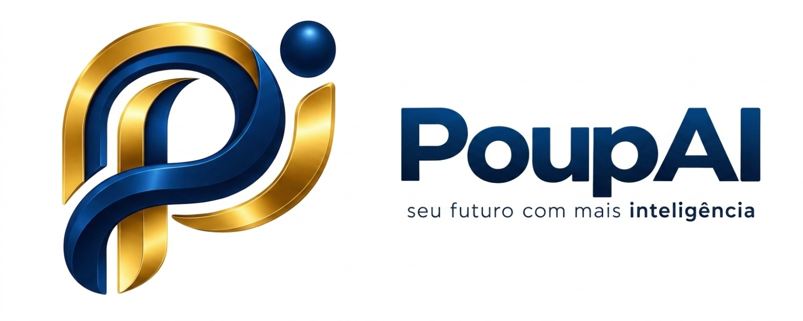
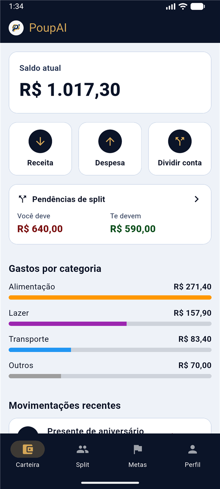
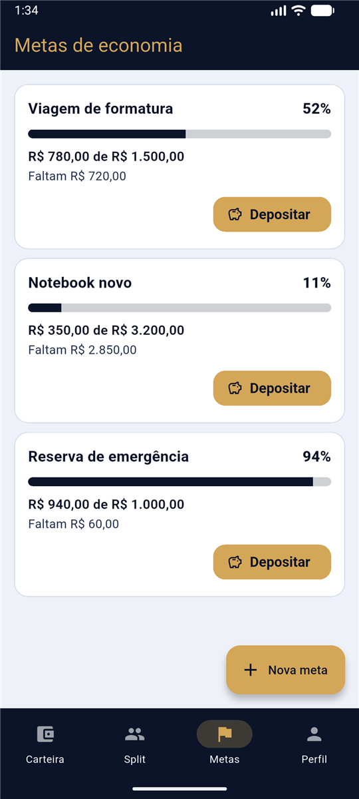

# PoupAI

App de finanças para quem vive de mesada, bolsa ou estágio: controle de gastos, divisão de contas entre amigos e metas de economia.

  

| Carteira | Dividir contas | Metas |
|---|---|---|
|  |  |  |

Capturas do APK de release em um emulador Android, com dados de exemplo. O app também tem tema escuro (veja todas as telas em [docs/HISTORICO.md](docs/HISTORICO.md)).

## O que o app faz

- **Carteira:** registra receitas e despesas por categoria, mostra o saldo, o gráfico de gastos por categoria e o que você deve e o que te devem.
- **Dividir contas:** cria grupos (ex.: república), divide uma despesa entre os integrantes e mostra **quem deve pagar quanto a quem**, no menor número de transferências. Dá para marcar um acerto como pago.
- **Metas:** define uma meta de economia, deposita aos poucos e acompanha o progresso e quanto falta.
- **Tema claro e escuro**, escolhido em Perfil → Aparência.

## Por que existe

Os apps de finanças mais conhecidos pensam em salário fixo. Quem vive de mesada ou bolsa tem gasto irregular e divide conta o tempo todo, e é isso que o PoupAI coloca no centro.

## Tecnologias

- **Flutter** (Dart) para o app Android, com tema claro e escuro.
- **Supabase** (PostgreSQL) como banco de dados. Os scripts estão em [`supabase/`](supabase).
- Camada de serviços com interface e duas implementações (dados fixos e Supabase), para as telas não dependerem do banco.
- Testes unitários das regras de negócio (saldo, cotas, acertos): `flutter test`.

## Instalar e rodar

- **Android:** baixe o APK na [Release v1.0.0](https://github.com/AndreNobrega125/CPs-456-Flutter-CPAD/releases/tag/v1.0.0) e instale (permitir "fontes desconhecidas"). Só precisa de internet.
- **Pelo código:** passo a passo, incluindo a criação do banco no Supabase e o arquivo `.env`, em [docs/COMO_RODAR.md](docs/COMO_RODAR.md).

## Limitações conhecidas

- Ainda não tem login de usuário: as políticas do Supabase estão abertas de propósito para o MVP, então não serve para produção como está.
- "Marcar como pago" é só um registro dentro do app, sem pagamento real.
- O "AI" do nome (categorização automática, sugestões de meta) ficou como ideia de produto e não foi implementado.

## Documentação

- [Histórico dos checkpoints (CP4, CP5 e CP6)](docs/HISTORICO.md): proposta de valor, marca, identidade visual, pitch, decisões técnicas, arquitetura, todas as telas e aprendizados do grupo.
- [Como rodar](docs/COMO_RODAR.md)

## Time

Projeto das Checkpoints 4, 5 e 6 de Cross-Platform Application Development (CPAD), FIAP, turma 2CCPG.

| Integrante | Papel |
|---|---|
| André Nobrega | Dev Flutter (estrutura e telas) |
| Caio Carminato | Documentação |
| Guilherme Tamai | Identidade visual, design e documentação |
| Mirella Mascarenhas | Pitch e modelo de negócio |
| Vitor Komura | Identidade visual e design |
